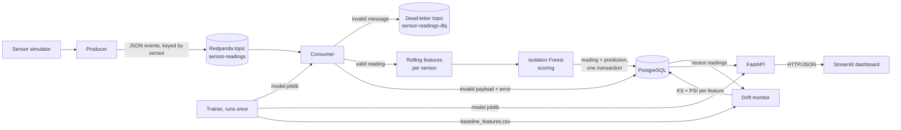

# StreamGuard

StreamGuard is a containerized, real-time anomaly-detection pipeline for IoT sensor data. It
simulates measurements from industrial equipment, streams them through Redpanda using the Kafka
protocol, validates and scores them with a versioned Isolation Forest model, stores the results in
PostgreSQL, monitors distribution drift, and exposes the system through FastAPI and Streamlit.

## The problem

Equipment sensors emit data continuously, and faults rarely announce themselves: a bearing starts to
vibrate, a sensor freezes on one value, or conditions slowly shift away from what a model was
trained on. A useful monitoring system has to answer three questions in near real time:

1. **Is this reading unusual?** (anomaly detection)
2. **Can the data be trusted?** (schema validation and a dead-letter queue)
3. **Is the model still seeing the kind of data it was trained on?** (drift monitoring)

StreamGuard answers all three in one small end-to-end system, on simulated data. It is a portfolio
project that demonstrates a data-intensive streaming architecture, an ML model integrated into the
stream, and software-quality practices: tests, CI, validation, structured logging, and monitoring.

## What the system analyzes

The simulator represents sensors attached to equipment such as a motor, pump, or manufacturing
machine. Each sensor produces three measurements:

| Measurement | Normal simulated behavior | Example operational meaning |
|---|---:|---|
| Temperature | approximately 25 °C | overheating or abnormal cooling |
| Humidity | approximately 50% | changing environmental conditions |
| Vibration | approximately 0.5 mm/s | imbalance, looseness, or mechanical wear |

These values naturally fluctuate, so one small change is not automatically a fault. StreamGuard
analyzes both the current values and their recent behavior to answer two different questions:

1. **Is this particular reading or recent sensor pattern unusual?** This is anomaly detection.
2. **Has the overall live-data distribution moved away from the training baseline?** This is drift
   detection.

### Sudden anomalies

A sharp temperature, humidity, or vibration change can represent abnormal equipment behavior. The
Isolation Forest assigns every valid reading an anomaly score. A reading is flagged when its score
is higher than the threshold learned from clean training data.

For example, a temperature near 25 °C may receive a score below the threshold, while a temperature
of 95 °C may be flagged as anomalous. The model considers all nine input features together rather
than applying a single hard-coded limit to each measurement.

### Stuck sensors

A repeated value can be suspicious even when the value itself looks normal:

```text
vibration: 0.51, 0.51, 0.51, 0.51, 0.51
```

StreamGuard maintains an independent five-reading window for every sensor. It calculates the rolling
mean and standard deviation of each measurement. A stuck sensor produces very low rolling variation,
giving the model information that would not be visible from one reading alone.

### Gradual distribution drift

A sensor population can change slowly without producing one extreme event:

```text
temperature: 25.0 → 25.3 → 25.7 → 26.2 → 27.0 → 28.5
```

The monitoring worker compares the newest live feature vectors with the clean training baseline. It
calculates the two-sample Kolmogorov-Smirnov statistic and Population Stability Index for every
feature. This identifies conditions where the model's current inputs no longer resemble the data on
which it was trained.

### Invalid data versus anomalous data

Data-quality failures and ML anomalies follow different paths:

| Input | Classification | Handling |
|---|---|---|
| `temperature = 95.0` | Valid but unusual | Sent to the model and potentially flagged |
| `temperature = "hot"` | Invalid type | Sent to the dead-letter queue |
| Missing `sensor_id` | Invalid schema | Sent to the dead-letter queue |
| Non-JSON payload | Invalid message | Sent to the dead-letter queue |

This separation ensures that unusual numeric values reach the anomaly detector while malformed data
does not contaminate model processing.

## Data flow



The simulator replaces physical hardware for local development. It can be replaced with a real
Kafka-producing IoT source without redesigning the consumer, model, database, API, monitoring, or
dashboard layers.

## Feature engineering and model

Every reading is transformed into nine model features:

```text
temperature, humidity, vibration,
temperature_mean, humidity_mean, vibration_mean,
temperature_std, humidity_std, vibration_std
```

Training and live inference use the same `RollingFeatures` implementation to prevent
training-serving skew. The model artifact contains the fitted Isolation Forest, anomaly threshold,
model version, feature names, window size, training metadata, and baseline statistics.

The default training process uses 20,000 clean simulated readings. The threshold is the 99th
percentile of anomaly scores from that clean data. Evaluation uses a separate 10,000-reading dataset
with injected spikes and stuck-value sequences. Current synthetic evaluation results are documented
in [reports/evaluation.md](reports/evaluation.md). These results validate system behavior on
controlled data; they are not claims of production accuracy on real equipment.

## Components

| Service | Responsibility |
|---|---|
| Producer | Generates sensor readings and publishes them to Redpanda |
| Redpanda | Provides Kafka-compatible event streaming and offset tracking |
| Consumer | Validates, creates features, scores, and persists events |
| Trainer | Builds and evaluates the model and writes its artifacts |
| PostgreSQL | Stores readings, predictions, rejected events, and drift metrics |
| Monitoring worker | Calculates KS and PSI drift statistics periodically |
| FastAPI | Exposes readings, anomalies, metrics, health, and prediction endpoints |
| Streamlit | Displays live telemetry and operational status |

## Project structure

Entry-point modules contain only configuration and process startup. Business logic is separated by
responsibility:

```text
common/                  shared configuration, schemas, tables, retries, and logging
producer/
  main.py                process composition and signal handling
  cli.py                 command-line configuration
  service.py             timed generation and Kafka publication loop
  payloads.py            JSON encoding and malformed-message injection
  simulator.py           sensor distributions, anomalies, and gradual drift
consumer/
  main.py                process composition and model loading
  service.py             Kafka batch orchestration and offset commits
  processing.py          message validation
  db.py                  transactional readings, predictions, DLQ, and outbox writes
  outbox.py              retryable Kafka publication for persisted dead letters
ml/
  train.py               training dataset, evaluation, and artifact generation
  features.py            per-sensor rolling feature calculation
  model.py               Isolation Forest artifact and scoring interface
monitoring/
  main.py                worker scheduling and lifecycle
  service.py             drift-check workflow
  repository.py          recent-feature reads and metric persistence
  drift.py               KS and PSI calculations
api/
  main.py                FastAPI application factory and router registration
  dependencies.py        database and model dependencies
  queries.py             shared SQL query builders
  routers/               system, reading, metric, and prediction endpoints
migrations/              versioned Alembic database schema changes
dashboard/
  app.py                 page composition and live refresh
  client.py              typed FastAPI client
  presentation.py        charts, data preparation, and drift display
  sidebar.py             controls and prediction form
  theme.py               page configuration and styling
scripts/
  demo.py                guided demo: normal traffic, anomalies, then drift
  load_test.py           throughput and end-to-end latency measurement
tests/                   unit, API, and container-backed integration tests
reports/                 model evaluation and load-test results
docs/                    architecture and operational walkthrough
```

## Processing guarantees

The consumer uses at-least-once processing:

- Kafka automatic offset commits are disabled.
- A batch is written to PostgreSQL before its offset is committed.
- Readings and their predictions are stored in one transaction.
- A unique `(sensor_id, timestamp)` constraint makes redelivery idempotent.
- Known duplicates are removed before rolling features and model scores are calculated.
- Rolling windows are restored from PostgreSQL on startup and are only advanced after a successful
  transaction.
- Invalid events and their outbox records are stored in one transaction; a retrying publisher then
  delivers them to the Kafka dead-letter topic.

If the consumer crashes after a database write but before committing its offset, Kafka redelivers the
message. PostgreSQL safely ignores the duplicate while preserving the original prediction.

## Quick start

Create the local environment file and start the complete stack:

```bash
cp .env.example .env
# Set POSTGRES_PASSWORD in .env
make secret
docker compose up -d --build
```

Compose runs `alembic upgrade head` as a one-shot migration service before the API, consumer, and
monitoring worker start. The migration container should finish with exit code `0`:

```bash
docker compose ps -a
docker compose logs migrate
```

Open:

- Dashboard: http://localhost:8501
- API documentation: http://localhost:8000/docs

Confirm that readings and predictions are being stored:

```bash
docker compose exec postgres psql -U streamguard -c \
  "select is_anomaly, count(*) from predictions group by is_anomaly"
```

If port 5432 is already used on your machine (for example by a local PostgreSQL), set
`POSTGRES_PORT=55432` in `.env`. Only host-side tools use that port; the containers talk to each
other directly and are unaffected.

## Guided demo

```bash
make demo
```

The demo walks through three stages, restarting only the producer between them:

1. **Normal traffic.** No faults; the drift monitor reports `ok`.
2. **Anomalies and malformed messages.** Spikes and stuck values reach the model and are flagged;
   malformed messages land in the dead-letter queue.
3. **Gradual drift.** Sensor means creep upward until the drift monitor flags the shifted features.

Watch the dashboard while it runs. Afterwards, `make demo-reset` returns the producer to normal
traffic. Without `make`, run `python -m scripts.demo` directly.

## Load test

```bash
make load-test
```

Publishes tagged test events at a fixed rate and then unthrottled, waits until every event is
stored, and reports throughput and end-to-end latency percentiles (written to
[reports/load_test_steady.md](reports/load_test_steady.md) and
[reports/load_test_peak.md](reports/load_test_peak.md)). Test rows are deleted afterwards. Stop the
normal producer first (`docker compose stop producer`) for a clean measurement.

## Configuring generated conditions

The producer behavior is controlled through `.env`:

```dotenv
NUM_SENSORS=5
EVENTS_PER_SECOND=10
RANDOM_SEED=42
ANOMALY_RATE=0.04
INVALID_RATE=0.02
DRIFT_PER_READING=0.001
```

- `ANOMALY_RATE` controls the probability of spikes or stuck-value sequences.
- `INVALID_RATE` controls the probability of malformed messages.
- `DRIFT_PER_READING` controls the gradual shift applied to sensor means.
- Set all three values to `0` for normal-data generation.

Recreate the producer after changing these values:

```bash
docker compose up -d --force-recreate producer
```

## Dashboard

The dashboard refreshes automatically and displays:

- live temperature, humidity, and vibration traces;
- highlighted anomaly locations and recent alerts;
- throughput and total processed readings;
- P50 and P95 end-to-end latency;
- dead-letter totals;
- model version and pipeline health;
- KS/PSI drift status for every feature;
- an interactive form for scoring a custom reading.

### Screenshots

_Placeholders: run `make demo`, then add captures to `docs/images/` and link them here._

| Normal traffic | Drift detected |
|---|---|
| `docs/images/dashboard-normal.png` | `docs/images/dashboard-drift.png` |

## API

| Endpoint | Purpose |
|---|---|
| `GET /health` | Verify database connectivity and loaded model version |
| `GET /readings/recent?sensor_id=&limit=` | Return recent readings with scores |
| `GET /anomalies?since=` | Return flagged readings from a selected period |
| `GET /metrics/pipeline?window_seconds=` | Return throughput, latency, anomaly, and DLQ metrics |
| `GET /metrics/drift` | Return the newest KS/PSI result for every feature |
| `POST /predict` | Score one reading without storing it |

Example prediction:

```bash
curl -X POST http://localhost:8000/predict \
  -H "content-type: application/json" \
  -H "X-API-Key: <value from .secrets/api_key>" \
  -d '{"sensor_id":"sensor-1","temperature":95,"humidity":50,"vibration":0.5}'
```

All data, metric, and prediction endpoints require this header. The dashboard receives the same key
as a read-only Docker secret. See [docs/security.md](docs/security.md) for setup, rotation, and the
remaining production security boundary.

## Drift monitoring

Training saves 5,000 clean feature vectors to `models/baseline_features.csv`. The monitoring worker
rebuilds the same nine features from the newest PostgreSQL readings and compares them with this
baseline. A feature is marked as drifted when either:

- PSI is at least `0.20`; or
- KS distance is at least `0.15` and its p-value is below `0.01`.

Results are written to the `drift_metrics` table and served through `/metrics/drift`.

## Database migrations

Alembic owns the PostgreSQL schema; application startup checks connectivity but never creates or
changes tables. The initial revision creates the storage tables and indexes used by the API,
consumer, outbox publisher, and monitoring queries.

Connection pools validate borrowed connections and recycle long-lived connections. Their size,
overflow, checkout timeout, and recycle interval are configurable with `DB_POOL_SIZE`,
`DB_MAX_OVERFLOW`, `DB_POOL_TIMEOUT_SECONDS`, and `DB_POOL_RECYCLE_SECONDS`.

Apply all pending revisions without restarting the whole stack:

```bash
make migrate
```

For a new schema change, update the SQLAlchemy metadata in `common/tables.py`, add a revision under
`migrations/versions/`, and test both a clean database and an upgrade of an existing database.

Retention cleanup, verified backups, and guarded restore procedures are documented in
[docs/database-operations.md](docs/database-operations.md). Cleanup is an explicit bounded
maintenance job; it never deletes unpublished outbox events.

## Results

All numbers come from a single development machine (Windows 11, 12 logical CPUs) running the whole
stack in Docker Compose, using simulated data. They show that the pipeline behaves as designed; they
are not benchmarks of real equipment or of production hardware.

**Anomaly detection** (10,000 held-out readings, 5% injected anomalies; details in
[reports/evaluation.md](reports/evaluation.md)):

| Precision | Recall | F1 |
|---:|---:|---:|
| 0.594 | 0.519 | 0.554 |

Compared with simple z-score detectors calibrated to the same 1% false-alarm rate on clean data:

| Method | Precision | Recall | F1 |
|---|---:|---:|---:|
| Isolation Forest (9 features) | 0.594 | 0.519 | 0.554 |
| Z-score, 3 raw values | 0.785 | 0.202 | 0.321 |
| Z-score, 9 features | 0.338 | 0.375 | 0.355 |

Recall by anomaly type (Isolation Forest / z-score on 9 features):

| Anomaly type | Readings | Isolation Forest | Z-score |
|---|---:|---:|---:|
| Spike | 253 | 95% | 100% |
| Stuck sensor, repeated readings | 940 | 51% | 28% |
| Stuck sensor, first reading | 235 | 11% | 9% |

The forest's advantage is on stuck sensors; z-scores catch every spike. Repeated stuck readings are
two thirds of all labelled anomalies, which is why overall recall is only about 0.52. The first
reading of a stuck episode is an exact copy of a normal reading, so neither method can find it.

**Pipeline throughput and latency** (latency = event timestamp until its prediction is stored):

| Run | Events | Lost | Throughput | Latency p50 / p95 |
|---|---:|---:|---:|---:|
| Steady, 100 events/sec | 3,000 | 0 | 100 events/sec | 81 ms / 137 ms |
| Unthrottled (peak) | 10,000 | 0 | about 2,500-3,000 events/sec | 1.5-2.1 s / 2.8 s* |

\* In the unthrottled run events queue up in Kafka faster than they are processed, so these
latencies measure the backlog, not normal operation (p50 range over four runs; p95 from the run
saved in `reports/load_test_peak.md`). The steady-run figures are the representative ones.

Shortening the consumer's batch wait from 1 s to 0.1 s (see below) cut the steady-run latency from
a median of about 530 ms (p95 about 980 ms) to 81 ms. Peak throughput was unchanged by it: three runs
each gave 2,539-2,965 events/sec before and 2,537-3,007 after.

**Drift detection:** in `make demo`, drift injected at 0.3 degrees/second was flagged by the monitor
about 20 seconds after it started (on `temperature` and `temperature_mean`), with the monitor
configured for a 500-reading window checked every 10 seconds.

## Design decisions and trade-offs

**Why Kafka (via Redpanda).** A durable, replayable log decouples the producer from the consumer:
the consumer can restart or fall behind without losing events, and keying messages by `sensor_id`
keeps each sensor's readings in order. Redpanda speaks the standard Kafka protocol from a single
container, which keeps `docker compose up` light; the services use the standard `confluent-kafka`
client, so nothing in the application code is Redpanda-specific. The trade-off is more moving parts
than polling a database, and this setup uses a single partition and a single consumer.

**Why an Isolation Forest.** It is unsupervised, so it trains on clean data alone and needs no
labelled faults. Scoring is fast and vectorised per batch, it needs no feature scaling, and it is
easy to explain. The trade-offs: it has no notion of time except through the rolling features, the
99th-percentile threshold fixes the false-alarm rate at roughly 1% on clean data by construction,
and recall is limited (0.52 here). The first reading of a stuck-value episode is an exact copy of a
normal reading, so it cannot be detected. Against z-score detectors calibrated to the same 1%
false-alarm rate, the forest scored an F1 of 0.55 versus 0.32 (raw values) and 0.36 (all nine
features): z-scores catch every spike but find far fewer stuck-sensor readings. Autoencoders and
sequence models were not tried.

**At-least-once delivery and duplicates.** Kafka auto-commit is off. The consumer writes a batch to
PostgreSQL and only then commits its offsets, so a crash can cause redelivery but never loss. A
unique `(sensor_id, ts)` constraint with `ON CONFLICT DO NOTHING` turns redelivered readings into
no-ops, and a reading and its prediction are written in one transaction. Exactly-once semantics
would need Kafka transactions and were out of scope.

**One PostgreSQL database for everything.** Readings, predictions, dead letters, and drift metrics
live in one store, so the API can use plain SQL (including percentile latency) and the services
share one source of truth. It is not a time-series database, which is fine at the load measured
above. The API and dashboard read from the database rather than from the consumer, so each service
can be restarted independently.

**Drift decision rule.** A feature is flagged if PSI is at least 0.20, or the KS distance is at
least 0.15 and its p-value is below 0.01. A p-value alone is unreliable here: in an experiment on
drift-free simulated data, the overlapping rolling-window features produced KS p-values as small as
1e-5, because consecutive values are correlated and the test assumes independence. The effect-size
gate prevents those false alarms. In simulation, clean windows were never flagged at
the default 1000-reading window (0 of 60) but 1 of 60 was at a 500-reading window, so a shorter
window detects drift sooner at the cost of an occasional false alarm. The thresholds were chosen on
simulator data and would need re-tuning for real sensors.

**Batching versus latency.** The consumer fetches up to 100 messages or waits up to 0.1 s,
whichever comes first (`POLL_TIMEOUT_SECONDS`). Batching keeps database writes and model scoring
efficient. The wait was originally 1 s, which dominated latency at low rates: an event waited on
average half the timeout for its batch to close, giving a median of about 0.5 s. Shortening it cut
the steady-run median to 81 ms without changing peak throughput (measured by running both settings
back to back). The trade-off is more, smaller database transactions at low event rates.

### Known limitations

- **Single partition, single consumer.** Scaling out would need more partitions and a shared or
  rebuilt rolling-feature state.
- **API-key authentication is service-level, not user-level.** It does not provide individual
  identities, roles, browser login, or audit attribution; an internet-facing deployment should use
  TLS, rate limiting, network policy, and OIDC/OAuth2 authorization.
- **Outbox delivery is at least once.** A crash after Kafka confirms a dead letter but before its
  outbox row is marked published can produce a duplicate Kafka dead-letter message. Consumers of
  that topic should de-duplicate using the outbox event key.
- **Synthetic data only.** Evaluation, thresholds, and drift behaviour are measured on simulator
  output; real equipment would need re-validation.
- **Load results are single-machine.** Throughput and latency depend on the host and on Docker
  Desktop; peak throughput varied between about 2,500 and 3,000 events/sec across runs.
- **The demo's short drift window can raise a false alarm.** About 1 in 60 clean checks at a
  500-reading window in simulation; the default 1000-reading window showed none.

## Development and testing

```bash
python -m venv .venv
.venv/Scripts/activate
pip install -r requirements-dev.txt
make lint
make test
```

Other targets: `make secret` (generate the local API credential), `make up` / `make down` (stack),
`make migrate` (apply database revisions),
`make retention-preview` / `make retention` (data lifecycle), `make backup` (verified database
archive), `make train` (retrain the model),
`make demo` / `make demo-reset` (guided demo), `make load-test` (latency and throughput).

The test suite covers simulation, schemas, rolling features, model training and scoring, consumer
processing, duplicate handling, dead-letter routing, API behavior, drift statistics, dashboard API
access, and container-backed integration. Docker must be running for tests that use Testcontainers.

See [docs/architecture.md](docs/architecture.md) for more detail about service boundaries, storage,
and delivery guarantees. Follow [docs/walkthrough.md](docs/walkthrough.md) for a concise operational
review of the running system.
