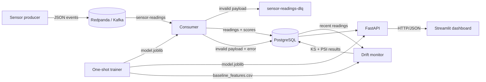

# StreamGuard architecture

## Runtime data flow

The producer, consumer, trainer, monitor, API, and dashboard are separate Python services. Docker
Compose supplies their configuration, internal DNS names, startup dependencies, shared model
mounts, and persistent PostgreSQL storage.

## Message contract

Every valid `sensor-readings` event contains a non-empty `sensor_id`, timezone-aware `timestamp`,
temperature, humidity, and vibration. Pydantic rejects malformed JSON, missing or extra fields,
non-finite numbers, wrong types, and values outside the broad physical ranges. Invalid events are
copied to the Kafka dead-letter topic and recorded in PostgreSQL with their validation error.

## Streaming inference

The consumer maintains a five-reading buffer per sensor. Each reading becomes a nine-value vector:
the three raw measurements, their three rolling means, and their three rolling standard deviations.
The same feature implementation is used in training and serving to avoid training-serving skew.
The versioned Isolation Forest artifact returns an anomaly score; values above the threshold learned
from the 99th percentile of clean training scores are flagged.

## Delivery and consistency

Kafka auto-commit is disabled. The consumer writes a batch to PostgreSQL before synchronously
committing its offsets, giving at-least-once delivery. A unique `(sensor_id, ts)` constraint and
`ON CONFLICT DO NOTHING` make redelivery idempotent. Each reading and its prediction are written in
one transaction, so a stored reading cannot be left without its corresponding prediction.

## Drift monitoring

Training saves a 5,000-row reference feature sample. The monitor periodically rebuilds features for
the newest live readings and computes a two-sample Kolmogorov-Smirnov test and Population Stability
Index for every feature. A practical effect-size threshold accompanies the KS p-value so large
samples do not create noisy alerts. The API returns the newest result for every feature, and the
dashboard displays the overall state and detailed statistics.

## Storage

| Table | Purpose |
|---|---|
| `readings` | Valid sensor values plus event and ingestion timestamps |
| `predictions` | Score, anomaly flag, model version, and scoring time per reading |
| `dlq_events` | Rejected raw payloads and validation errors |
| `drift_metrics` | Timestamped KS, PSI, decision, and live window size per feature |

For this local portfolio system, SQLAlchemy creates tables idempotently at startup. A production
deployment would replace that with versioned migrations, external secrets, authentication,
multi-partition Kafka, and durable restoration of the consumer's rolling feature state.
